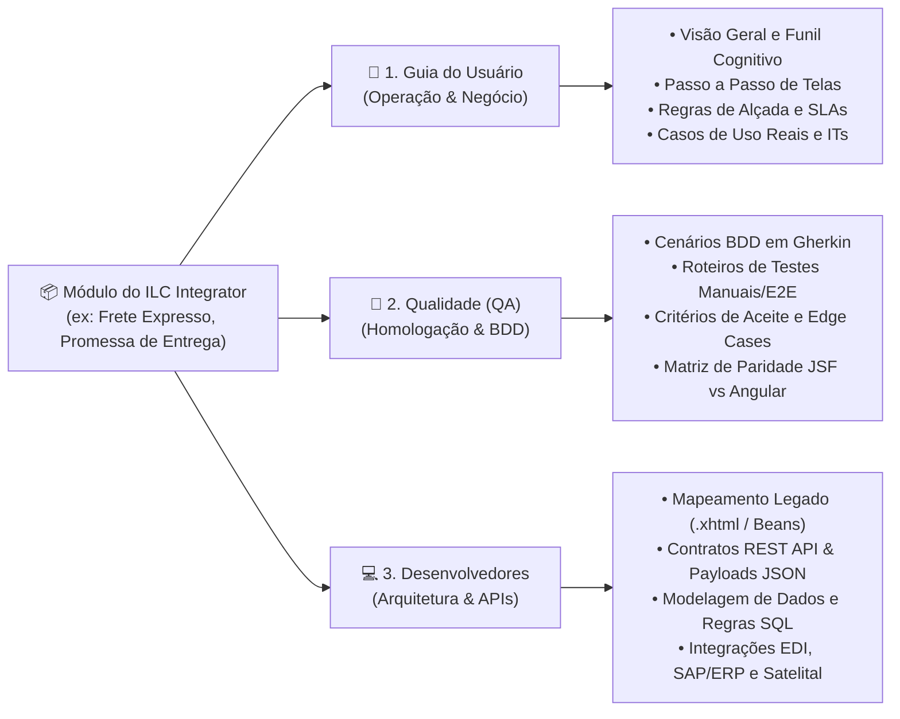
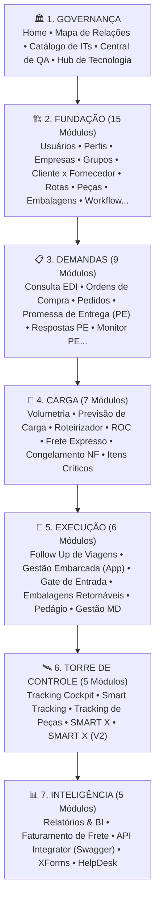

# 🏢 Portal de Documentação — ILC Integrator (Docs Hub)


> **Fonte Única da Verdade (*Single Source of Truth*)** do ecossistema logístico **ILC Integrator**.  
> Este portal unifica o **Manual Operacional do Usuário**, o **Catálogo Normativo de Instruções de Trabalho (ITs/POPs)**, a **Central de Qualidade (QA, BDD/Gherkin e Roteiros de Homologação)** e o **Hub de Engenharia e Arquitetura (Legado JSF/PrimeFaces ➔ Modernização Angular + Microsserviços Spring Boot/REST)**.

---

## 📑 Sumário

1. [Visão Geral do Projeto](#-1-visão-geral-do-projeto)
2. [A Tríade de Perspectivas (Arquitetura Cognitiva)](#-2-a-tríade-de-perspectivas-arquitetura-cognitiva)
3. [Funcionalidades e Recursos Interativos](#-3-funcionalidades-e-recursos-interativos)
4. [Arquitetura e Taxonomia dos 7 Macro-Pilares (52+ Módulos)](#-4-arquitetura-e-taxonomia-dos-7-macro-pilares-52-módulos)
5. [Acervo de Instruções de Trabalho (ITs e POPs)](#-5-acervo-de-instruções-de-trabalho-its-e-pops)
6. [Estrutura de Diretórios do Repositório](#-6-estrutura-de-diretórios-do-repositório)
7. [Como Executar o Projeto Localmente](#-7-como-executar-o-projeto-localmente)
8. [Exportação Automatizada de PDF (Central de QA)](#-8-exportação-automatizada-de-pdf-central-de-qa)
9. [Automação e Sincronização com Azure DevOps Wiki](#-9-automação-e-sincronização-com-azure-devops-wiki)
10. [Como Adicionar ou Atualizar Documentações](#-10-como-adicionar-ou-atualizar-documentações)
11. [Ambientes Oficiais do Ecossistema ILC Integrator](#-11-ambientes-oficiais-do-ecossistema-ilc-integrator)
12. [Segurança, Governança e Conformidade (LGPD)](#-12-segurança-governança-e-conformidade-lgpd)

---

## 🎯 1. Visão Geral do Projeto

O **ILC Integrator** é a plataforma corporativa e Torre de Controle Logístico (*Control Tower*) da **ILC (Integrator Logistics Company)**, responsável por conectar indústrias embarcadoras, fornecedores produtivos/indiretos, transportadoras, operadores logísticos e gerenciadoras de risco em tempo real.

Com o avanço da operação e o projeto estratégico de **Modernização Tecnológica (Migração do Legado Java JSF/PrimeFaces para Angular + APIs REST)**, surgiu a necessidade de consolidar todo o conhecimento funcional, normativo e técnico em um único portal web rápido, pesquisável, responsivo e independente de banco de dados externo (*Zero-Dependency SPA*).

### Principais Objetivos do Docs Hub:
- **Onboarding e Treinamento Operacional:** Capacitar operadores logísticos, analistas de transporte, fornecedores e transportadores com guias passo a passo e casos de uso reais.
- **Governança Normativa (ITs & POPs):** Centralizar a consulta e leitura imediata de mais de **35 Instruções de Trabalho (`IT.OPE`) e Procedimentos Operacionais Padrão (`P.OPE`)** diretamente no navegador.
- **Engenharia de Qualidade (Shift-Left QA):** Fornecer especificações em **BDD (Gherkin)**, matrizes de rastreabilidade, contratos de teste E2E (Playwright) e API (Jest/Supertest) para garantir 100% de paridade funcional entre o sistema legado e a nova arquitetura.
- **Documentação Técnica Viva:** Mapear ManagedBeans JSF, páginas `.xhtml`, tabelas de banco de dados, layouts EDI (PROCEDA: `NOTFIS`, `CONEMB`, `OCOREN`, `DOCCOB`), Webhooks e endpoints Swagger/OpenAPI.

---

## 🏛️ 2. A Tríade de Perspectivas (Arquitetura Cognitiva)

Cada módulo documentado no portal conta com um seletor dinâmico de **3 perspectivas complementares**, permitindo que diferentes perfis naveguem pelo mesmo módulo sob a ótica exata de sua atribuição:



> **Deep-Linking de Rotas e Perspectivas:**  
> O roteador SPA (`DocsApp`) suporta URLs diretas no formato `#<id_do_modulo>/<perspectiva>`.  
> Exemplos:
> - `#frete_expresso/user` ➔ Abre **Frete Expresso** diretamente na aba **Guia do Usuário**.
> - `#frete_expresso/qa` ➔ Abre **Frete Expresso** diretamente na aba **Qualidade (QA)**.
> - `#frete_expresso/dev` ➔ Abre **Frete Expresso** diretamente na aba **Desenvolvedores**.

---

## ✨ 3. Funcionalidades e Recursos Interativos

O portal foi projetado com foco em **Developer Experience (DX)** e **User Experience (UX)** de alto padrão:

| Recurso | Descrição Detalhada | Atalho / Ação |
| :--- | :--- | :--- |
| **🔍 Command Palette (Busca Global Indexada)** | Motor de busca em memória ([`search-engine.js`](docs-portal/assets/js/search-engine.js)) que indexa títulos, subtítulos, resumos e o conteúdo integral das 3 perspectivas (`user`, `qa`, `dev`) de todos os módulos, retornando resultados instantâneos classificados por categoria e perspectiva. | `Ctrl + K` ou `Cmd + K` (`ESC` para fechar) |
| **🗺️ Visualizador Mermaid com Zoom & Pan** | Todos os fluxogramas de arquitetura, máquinas de estado e diagramas de sequência são renderizados via **Mermaid.js v10**. Ao clicar sobre qualquer diagrama, abre-se um modal em alta resolução com controles de Zoom (`+`, `-`, `Reset`), suporte a roda do mouse (*scroll wheel*) e arraste livre (*drag-to-pan*). | Clique no diagrama (`ESC` para fechar) |
| **📄 Leitor Nativo de PDF (Modal de ITs)** | Visualizador embutido para leitura imediata das Instruções de Trabalho (`.pdf`) sem sair da página, acompanhado de botões para **Download Direto** ou **Abertura em Nova Guia**. | Botão `📄 Ler IT` nos módulos ou no Catálogo de ITs |
| **🌓 Tema Claro / Escuro (Dark Mode)** | Alternância instantânea entre tema Claro e Escuro via variáveis CSS (`data-theme="light"` / `data-theme="dark"`), com persistência automática em `localStorage` (`ilc_docs_theme`), troca dinâmica de logotipos e re-renderização adaptativa dos diagramas. | Botão `🌙 / ☀️` no cabeçalho |
| **🧭 Sidebar Inteligente com Agrupamento** | Menu lateral organizado nos 7 macro-pilares da cadeia logística, com contadores de módulos, expansão automática do grupo ativo, botão global **Expandir/Recolher Todos** e suporte responsivo para dispositivos móveis. | Menu lateral esquerdo |
| **🔗 Sistema de Aliases de Rotas** | Resolução inteligente de sinônimos e rotas legadas no [`docs-app.js`](docs-portal/assets/js/docs-app.js), garantindo que links cruzados entre módulos nunca quebrem. | Automático via Hash Router |
| **🖨️ Motor de Exportação PDF (Central de QA)** | Template editorial dedicato ([`export_central_qa.html`](docs-portal/export_central_qa.html)) otimizado para impressão paginada A4 e geração automatizada via Microsoft Edge / Google Chrome Headless. | `npm run export:pdf` |

---

## 🗺️ 4. Arquitetura e Taxonomia dos 7 Macro-Pilares (52+ Módulos)

A documentação está estruturada seguindo a ordem cronológica e sistêmica da operação logística no **ILC Integrator**, dividida em **7 Macro-Pilares**:



### Detalhamento Completo por Pilar

#### 🏛️ Pilar 1: Governança (5 Módulos)
| ID da Rota | Módulo | Escopo Documentado |
| :--- | :--- | :--- |
| `#home` | **Home** | Visão institucional da ILC, pilares de atuação, arquitetura da plataforma, ambientes oficiais e conformidade LGPD. |
| `#mapa_mental` | **Mapa de Relações** | Visão holística da esteira logística, ordem de dependência de cadastros e ciclo de vida completo da operação. |
| `#instrucoes_trabalho` | **Catálogo de ITs** | Índice centralizado com busca, filtro e leitura integrada dos manuais normativos (`IT.OPE`, `P.OPE` e Auditorias). |
| `#central_qa` | **Central de QA** | Diretrizes mestras de qualidade, pirâmide de testes (Playwright + Jest), fluxo de bugs, DoR/DoD e integração Azure DevOps. |
| `#hub_tecnologia` | **Hub de Tecnologia** | Diretrizes de engenharia de software, matriz de migração JSF ➔ Angular, barramento EDI, padrão REST e infraestrutura. |

#### 🏗️ Pilar 2: Fundação — Cadastros Base & Parametrizações (15 Módulos)
| ID da Rota | Módulo | Escopo Documentado |
| :--- | :--- | :--- |
| `#cad_usuarios` | **Usuário** | Gestão de credenciais, atribuição de perfis RBAC, vínculo multi-empresa e políticas de senha (`IT.OPE.22`). |
| `#cad_perfis` | **Perfil** | Governança de segurança, matriz de permissões por funcionalidade e níveis de alçada. |
| `#cad_empresas` | **Empresa** | Estrutura corporativa multi-tenant, CNPJs de matrizes/filiais, transportadoras e integração SSO Azure AD. |
| `#cad_grupos_empresas` | **Grupo Empresas** | Agrupamento societário multi-CNPJ, holdings e visão consolidada para a Torre de Controle. |
| `#cad_cliente_fornecedor` | **Cliente x Fornecedor** | Vínculo operacional e comercial entre plantas clientes, fornecedores e analistas responsáveis. |
| `#cad_contatos_upload` | **Upload Contatos** | Importação em lote de contatos comerciais, e-mails de alerta e telefones via planilha padronizada. |
| `#cad_prazos_entrega` | **Prazos de Entrega** | Matriz de *lead times* por rota, tolerâncias operacionais e regras de cálculo da Promessa de Entrega. |
| `#cad_rotas` | **Cadastro de Rotas** | Definição de trajetos padrão, pontos de parada, praças de pedágio e quilometragem (`IT.OPE.34`). |
| `#cad_frequencias` | **Frequências** | Parametrização de janelas fixas de coleta, dias da semana e horários de carregamento (*Milk Run*). |
| `#cad_pecas` | **Cliente Peça** | Catálogo técnico de itens/peças (*Part Numbers*), unidades de medida, pesos e dimensões. |
| `#cad_itens_especiais` | **Itens Especiais** | Parametrização de peças estratégicas com monitoramento prioritário e risco de parada de linha. |
| `#cad_embalagens` | **Cadastro Embalagem** | Especificações técnicas de racks, pallets, caixas KLT, empilhamento e fatores de cubagem. |
| `#cad_motivos_congelamento` | **Motivo Congel. NF** | Tabela de motivos padronizados para retenção preventiva de Notas Fiscais e bloqueio de faturamento. |
| `#cad_config_comprovante` | **Configuração de Comprovantes** | Regras de captura obrigatória de canhotos digitais, fotos de entrega e assinatura eletrônica por cliente. |
| `#cad_workflow` | **Workflow** | Configuração de alçadas de aprovação financeira/operacional, matriz de solicitantes e hierarquia de decisão. |

#### 📋 Pilar 3: Demandas — Planejamento & Programação (9 Módulos)
| ID da Rota | Módulo | Escopo Documentado |
| :--- | :--- | :--- |
| `#consulta_edi` | **Consulta EDI** | Rastreabilidade de arquivos eletrônicos (`NOTFIS`, `CONEMB`, `OCOREN`), logs de parser e layouts PROCEDA (`IT.OPE.29`). |
| `#solicitacao_ordem_compra` | **Solic Ordem Compra** | Emissão manual de ordens de compra extraordinárias e demandas avulsas de fornecimento (`IT.OPE.38`). |
| `#consulta_ordem_compra` | **Consulta de Ordem** | Painel de rastreabilidade de pedidos de compra por número, linha, status e fornecedor. |
| `#gestao_pedidos` | **Pedidos** | Central unificada de gestão de pedidos, alocação de transportadores e liberação para coleta. |
| `#pedidos_transportador` | **Pedidos Transportador** | Visão dedicada às transportadoras com ordens de coleta liberadas para embarque (`IT.OPE.05`). |
| `#promessa_entrega` | **Promessa de Entrega** | Fluxo completo de materiais produtivos (`IT.OPE.01`) e indiretos (`IT.OPE.02`). |
| `#respostas_promessa` | **Respostas Promessa** | Portal de resposta formal dos fornecedores, confirmação de volumes e aceite de prazos (`IT.OPE.27`). |
| `#monitor_pe` | **Monitor PE** | Cockpit semafórico de cumprimento de prazos de fornecedores, atrasos e *lead times* (`IT.OPE.31`). |
| `#gestao_demanda` | **Gestão de Demandas** | Previsão de volume por região, nivelamento de frota e análise de capacidade de transporte. |

#### 📐 Pilar 4: Carga — Cubagem, Roteirização & Urgências (7 Módulos)
| ID da Rota | Módulo | Escopo Documentado |
| :--- | :--- | :--- |
| `#consulta_volumetria` | **Consulta Volumetria** | Cálculo volumétrico em $m^3$, pesos brutos/líquidos e fator de cubagem de cargas (`IT.OPE.30`). |
| `#previsao_carga` | **Previsão de Carga** | Planejamento de embarques futuros, agrupamento de volumes e pré-alocação de veículos. |
| `#roteirizador` | **Roteirizador** | Otimização de rotas de *Milk Run*, janelas de coleta e sequenciamento inteligente de paradas. |
| `#relatorio_ocupacao_carga` | **ROC** | Relatório de Ocupação de Carga, auditoria de aproveitamento volumétrico e redução de frete morto (`Auditorias de ROCs`). |
| `#frete_expresso` | **Frete Expresso** | Esteira ponta a ponta de fretes críticos em 7 etapas: Solicitação, Cotação, Aprovação, Código NOX/PFR, Fiscal, Coleta e Histórico (`IT.OPE.04`, `IT.OPE.53` a `57`). |
| `#congelamento_nf` | **Congel. de Notas** | Bloqueio e desbloqueio preventivo de Notas Fiscais com divergências fiscais ou operacionais (`IT.OPE.11`). |
| `#itens_criticos` | **Itens Críticos** | Matriz de criticidade de estoque (*Stock-Out*), peças com risco de ruptura e escalonamento (`IT.OPE.20`). |

#### 🚚 Pilar 5: Execução — Trânsito, Pátio & Ativos (6 Módulos)
| ID da Rota | Módulo | Escopo Documentado |
| :--- | :--- | :--- |
| `#followup_viagens` | **Follow Up de Viagens** | Monitoramento de rotas em trânsito, apontamento de marcos operacionais e ocorrências (`IT.OPE.21`). |
| `#gestao_embarcada` | **Gestão Embarcada** | Aplicativo mobile para motoristas, check-in, assinatura eletrônica (`IT.OPE.59`) e digitalização de canhotos (`IT.OPE.08`). |
| `#gate_entrada` | **Gate De Entrada** | Controle de acesso de veículos na portaria, triagem de NFs, fila de pátio e chamada de doca. |
| `#gestao_embalagem` | **Gestão Embalagem** | Controle de saldo de embalagens retornáveis vazias, devolução de racks/KLT e frete extra (`P.OPE.04`). |
| `#gestao_pedagios` | **Gestão Pedágio** | Roteirização de praças, compra automatizada de créditos (Sem Parar / Veloe) e conciliação (`IT.OPE.06`). |
| `#gestao_md` | **Gestão MD** | Gestão de motoristas e veículos dedicados (Mão de Obra Dedicada), documentação e jornada. |

#### 🛰️ Pilar 6: Torre de Controle — Visibilidade & Telemetria (5 Módulos)
| ID da Rota | Módulo | Escopo Documentado |
| :--- | :--- | :--- |
| `#cockpit` | **Tracking Cockpit** | Monitoramento em tempo real, gestão à vista, semáforos de SLA e controle de anomalias (`IT.OPE.51`). |
| `#smart_tracking` | **Smart Tracking** | Rastreamento satelital integrado com gerenciadoras de risco (Buonny, AngelLira, Sascar, Omnilink). |
| `#tracking_pecas` | **Tracking** | Rastreamento granular por *Part Number*, lote, Nota Fiscal e embalagem (`IT.OPE.09`). |
| `#smart_x` | **SMART X** | Plataforma avançada de telemetria e conectividade veicular integrada. |
| `#smart_x_v2` | **SMART X (V2)** | Nova geração da plataforma SMART X com algoritmos preditivos de chegada (ETA dinâmico). |

#### 📊 Pilar 7: Inteligência — BI, Finanças, APIs & Suporte (5 Módulos)
| ID da Rota | Módulo | Escopo Documentado |
| :--- | :--- | :--- |
| `#relatorios_bi` | **Lista Relatórios** | Central de relatórios gerenciais, dashboards executivos (`IT.OPE.24`), KPIs e gestão de comunicação (`IT.OPE.43`, `IT.OPE.45`). |
| `#faturamento_frete` | **Faturamento** | Auditoria de CT-e, faturamento Onze Onze (`IT.OPE.18`), Fretes Expressos (`IT.OPE.46`), Pedágios (`IT.OPE.47`), MRO (`IT.OPE.48`), MRM (`IT.OPE.49`) e Broker (`IT.OPE.50`). |
| `#api_gateway_swagger` | **API Integrator** | Catálogo de APIs REST, documentação OpenAPI 3.0 / Swagger, autenticação JWT e Webhooks. |
| `#xforms_formularios` | **XForms (Formulários)** | Motor de formulários dinâmicos, checklists de inspeção veicular e auditorias de qualidade. |
| `#helpdesk_suporte` | **HelpDesk** | Central de abertura de chamados, níveis de acordo de serviço (SLA) e suporte operacional. |

---

## 📚 5. Acervo de Instruções de Trabalho (ITs e POPs)

O repositório armazena e disponibiliza para leitura direta mais de **35 documentos normativos oficiais em PDF**, sincronizados tanto na pasta de ativos do portal ([`docs-portal/assets/docs/its/`](docs-portal/assets/docs/its)) quanto no diretório raiz de governança ([`Instruções de Trabalho ILC/`](Instruções%20de%20Trabalho%20ILC)):

| Código | Título Oficial do Documento Normativo | Revisão / Data |
| :--- | :--- | :---: |
| **IT.OPE.01** | Promessa de Entrega — Materiais Produtivos | REV.00 (28/03/2025) |
| **IT.OPE.02** | Promessa de Entrega — Materiais Indiretos | REV.02 (17/03/2025) |
| **IT.OPE.04** | Frete Expresso | REV.02 (14/02/2025) |
| **IT.OPE.05** | Pedidos Transportador | REV.00 (22/04/2025) |
| **IT.OPE.06** | Gestão de Pedágios | REV.00 (21/07/2025) |
| **IT.OPE.08** | Gestão Embarcada — Aplicativo Mobile | REV.05 (19/03/2025) |
| **IT.OPE.09** | Tracking de Peças e Embalagens | REV.01 (05/02/2025) |
| **IT.OPE.11** | Congelamento de Notas Fiscais | REV.00 (06/02/2025) |
| **IT.OPE.18** | Faturamento Onze Onze | REV.02 (03/09/2025) |
| **IT.OPE.20** | Sinalização de Itens Críticos | REV.03 (28/03/2025) |
| **IT.OPE.21** | Follow Up de Viagens | REV.01 (27/02/2025) |
| **IT.OPE.22** | Alteração de Senha | REV.01 (17/01/2025) |
| **IT.OPE.24** | Home Dashboard | REV.00 (17/02/2025) |
| **IT.OPE.27** | Resposta de Promessa | REV.00 (24/04/2025) |
| **IT.OPE.29** | Consulta EDI | REV.00 (20/03/2025) |
| **IT.OPE.30** | Consulta Volumetria | REV.00 (18/03/2025) |
| **IT.OPE.31** | Monitor PE (Promessa de Entrega) | REV.00 (18/03/2025) |
| **IT.OPE.34** | Cadastro de Rotas | REV.00 (28/04/2025) |
| **IT.OPE.38** | Solicitação de Ordem de Compra | REV.00 (21/07/2025) |
| **IT.OPE.43** | Relatórios | REV.00 (15/04/2025) |
| **IT.OPE.45** | BI — Gestão de Comunicação | REV.00 (11/03/2025) |
| **IT.OPE.46** | Faturamento ILC — Fretes Expressos | REV.00 (21/03/2025) |
| **IT.OPE.47** | Faturamento Serviço de Pedágios | REV.00 (21/03/2025) |
| **IT.OPE.48** | Faturamento MRO | REV.01 (25/07/2025) |
| **IT.OPE.49** | Faturamento ILC — MRM | REV.03 (02/04/2025) |
| **IT.OPE.50** | Faturamento ILC — Broker | REV.01 (01/04/2025) |
| **IT.OPE.51** | Tracking Logístico — Control Tower | REV.02 (10/03/2025) |
| **IT.OPE.53** | Confirmação de PFR | REV.00 (16/05/2025) |
| **IT.OPE.54** | Código Planner Não Conhecido | REV.00 (20/05/2025) |
| **IT.OPE.55** | PFRs Sem Registro no Portal ILC | REV.00 (06/06/2025) |
| **IT.OPE.56** | Solicitação de Acesso PFR | REV.00 (06/05/2025) |
| **IT.OPE.57** | Validação Acesso PFR | REV.00 (25/07/2025) |
| **IT.OPE.59** | Criação de Assinatura Eletrônica | REV.00 (30/07/2025) |
| **P.OPE.04** | Priorização e Frete Extra para Entrega de Embalagens | REV.02 (28/03/2025) |
| **P.OPE.06** | Notificação "Risco de Não Envio de Coleta — Frete Morto" | REV.00 (07/08/2025) |
| **AUD.ROC** | Auditorias de ROCs (Relatório de Ocupação de Carga) | Vigente |

---

## 📂 6. Estrutura de Diretórios do Repositório

```text
Docs_Portal/
├── docs-portal/                           # Aplicação Web Principal (SPA do Portal de Documentação)
│   ├── index.html                         # Shell principal da SPA (Header, Sidebar, Modais e Containers)
│   ├── export_central_qa.html             # Layout editorial paginado A4 para geração do PDF da Central de QA
│   └── assets/
│       ├── css/
│       │   ├── docs-theme.css             # Design Tokens, variáveis CSS, paleta ILC e temas Light/Dark
│       │   ├── docs-layout.css            # Grid principal, Header fixo, Sidebar colapsável e Responsividade
│       │   └── docs-components.css        # Cards, Callouts, Tabelas, Abas de Perspectiva, Modais e Badges
│       ├── js/
│       │   ├── docs-database.js           # Base de Conhecimento completa (58 artigos e 3 perspectivas por módulo)
│       │   ├── search-engine.js           # Motor de indexação full-text em memória e filtro da Command Palette
│       │   └── docs-app.js                # Controlador principal, Hash Router, Mermaid Zoom/Pan e Leitor de PDF
│       ├── img/
│       │   ├── Claro.png                  # Logotipo oficial ILC Integrator para fundo claro
│       │   ├── Escuro.png                 # Logotipo oficial ILC Integrator para fundo escuro
│       │   └── ...                        # Ativos visuais e ícones institucionais
│       └── docs/
│           └── its/                       # Acervo de PDFs das Instruções de Trabalho servidos pela aplicação
│
├── Instruções de Trabalho ILC/            # Pasta espelho de governança com os PDFs originais e manuais mestres
│   ├── Central de QA - Diretrizes Mestras de Qualidade ILC Integrator.pdf
│   └── IT.OPE.*.pdf / P.OPE.*.pdf
│
├── scripts/                               # Scripts de Automação, Servidor Local e Integração Azure DevOps
│   ├── server.js                          # Servidor HTTP local zero-dependency em Node.js
│   ├── gerar_pdf_central_qa.bat           # Automação Headless (Edge/Chrome) para gerar o PDF da Central de QA
│   ├── update_wiki*.py                    # Scripts Python para publicação automatizada na Wiki do Azure DevOps
│   ├── reorganize_wiki_pilares.py         # Script de estruturação da arquitetura de pilares na Wiki corporativa
│   └── fix_mermaid*.py / fix_wiki*.py     # Utilitários de normalização de diagramas Mermaid e listas Markdown
│
├── Central_de_QA_ILC_Integrator.pdf       # Versão compilada em PDF da Central de QA (gerada automaticamente)
├── package.json                           # Manifesto do projeto e scripts de execução rápida (npm start)
├── .env.example                           # Modelo de variáveis de ambiente para os scripts do Azure DevOps
├── .gitignore                             # Regras de exclusão do Git (proteção de segredos e arquivos temporários)
├── .gitattributes                         # Tratamento de quebras de linha e binários (PDF/PNG) no Git
└── README.md                              # Documentação completa do projeto (este arquivo)
```

---

## 🚀 7. Como Executar o Projeto Localmente

Por ser uma **Single Page Application (SPA) em Vanilla JavaScript** sem dependências de compilação pesadas, você pode executar o projeto de três maneiras diferentes:

### Opção 1: Via Node.js / NPM (Recomendado)
O projeto inclui um servidor HTTP dedicado ([`scripts/server.js`](scripts/server.js)) que configura todos os cabeçalhos MIME (`.html`, `.css`, `.js`, `.pdf`, `.svg`) e abre o navegador automaticamente:

```bash
# Iniciar o servidor na porta 8080 e abrir no navegador padrão
npm start

# Ou apenas iniciar o servidor sem abrir nova aba
npm run serve
```
> O portal estará disponível em: **`http://localhost:8080`**  
> Para usar outra porta, defina a variável `PORT` (ex: `PORT=3000 npm start`).

### Opção 2: Via Python HTTP Server
Caso tenha Python 3 instalado no ambiente:

```bash
python -m http.server 8080 --directory docs-portal
```

### Opção 3: Abertura Direta (`file://`) ou VS Code Live Server
Como a base de conhecimento ([`docs-database.js`](docs-portal/assets/js/docs-database.js)) é carregada via tag `<script>` padrão (sem depender de chamadas `fetch()` bloqueadas por CORS em `file://`), você também pode abrir diretamente o arquivo [`docs-portal/index.html`](docs-portal/index.html) em qualquer navegador moderno (Chrome, Edge, Firefox, Safari) ou usar a extensão **Live Server** do VS Code.

---

## 🖨️ 8. Exportação Automatizada de PDF (Central de QA)

O projeto possui um pipeline automatizado para compilar a **Central de QA — Diretrizes Mestras de Qualidade ILC Integrator** em um documento PDF paginado de alta definição:

1. O arquivo [`docs-portal/export_central_qa.html`](docs-portal/export_central_qa.html) formata todo o conteúdo da Central de QA com regras CSS `@media print` e `@page` específicas para folha A4, preservando cores, tabelas e diagramas.
2. O script [`scripts/gerar_pdf_central_qa.bat`](scripts/gerar_pdf_central_qa.bat) aciona o **Microsoft Edge** (ou **Google Chrome**) em modo `--headless` para renderizar o HTML/Mermaid e exportar o PDF final.
3. O PDF gerado é salvo automaticamente em dois locais:
   - Na raiz do projeto: [`Central_de_QA_ILC_Integrator.pdf`](Central_de_QA_ILC_Integrator.pdf)
   - Na pasta de governança: `Instruções de Trabalho ILC/Central de QA - Diretrizes Mestras de Qualidade ILC Integrator.pdf`

### Como executar a geração do PDF:
```bash
npm run export:pdf
# Ou diretamente no Windows PowerShell / CMD:
.\scripts\gerar_pdf_central_qa.bat
```

---

## 🔄 9. Automação e Sincronização com Azure DevOps Wiki

O diretório [`scripts/`](scripts) contém um conjunto de scripts em **Python 3** desenvolvidos para sincronizar automaticamente a documentação técnica, matrizes de paridade (JSF vs Angular), planos de testes e cenários BDD com a **Wiki Oficial do Azure DevOps** (Projeto `Migração Angular Integrator V0`).

### Configuração de Segurança (Variáveis de Ambiente)
Por segurança, **nenhum token de acesso (PAT) é armazenado no código-fonte**. Antes de executar qualquer script Python de sincronização com o Azure DevOps, defina a variável de ambiente `AZURE_DEVOPS_PAT`:

**No Windows PowerShell:**
```powershell
$env:AZURE_DEVOPS_PAT = "SEU_PERSONAL_ACCESS_TOKEN_AQUI"
python scripts/update_wiki.py
```

**No Linux / macOS / Git Bash:**
```bash
export AZURE_DEVOPS_PAT="SEU_PERSONAL_ACCESS_TOKEN_AQUI"
python3 scripts/update_wiki.py
```

### Principais Scripts Disponíveis em `scripts/`:
| Script | Finalidade |
| :--- | :--- |
| [`update_wiki.py`](scripts/update_wiki.py) | Atualiza a página principal de Resumo Executivo do Plano de Testes e Estratégia de QA na Wiki do Azure DevOps. |
| [`update_wiki_00_rich.py`](scripts/update_wiki_00_rich.py) | Publica a visão executiva enriquecida da arquitetura de testes e governança. |
| [`update_wiki_01_modules.py`](scripts/update_wiki_01_modules.py) | Sincroniza o mapeamento detalhado e a Matriz de Paridade Funcional (Legado JSF vs Novo Angular). |
| [`update_wiki_02_bdd.py`](scripts/update_wiki_02_bdd.py) | Publica o catálogo de especificações BDD (Gherkin) para Core Security (`TC_CORE_*`) e Frete Expresso (`TC_FE_*`). |
| [`update_wiki_03_structure.py`](scripts/update_wiki_03_structure.py) | Atualiza a documentação de arquitetura dos repositórios de testes automatizados (Playwright & Jest). |
| [`reorganize_wiki_pilares.py`](scripts/reorganize_wiki_pilares.py) | Reorganiza a árvore de páginas da Wiki corporativa alinhada aos pilares de engenharia e QA. |
| [`fix_mermaid_*.py`](scripts/fix_mermaid_home.py) | Utilitários de validação e correção sintática de blocos Mermaid compatíveis com o renderizador do Azure DevOps. |

---

## 🛠️ 10. Como Adicionar ou Atualizar Documentações

A manutenção do portal é simples e centralizada:

### Passo 1: Registrar ou editar o conteúdo em `docs-database.js`
Abra [`docs-portal/assets/js/docs-database.js`](docs-portal/assets/js/docs-database.js) e adicione/edite a chave correspondente ao módulo no objeto global `DOCS_DATABASE`:

```javascript
meu_novo_modulo: {
  id: "meu_novo_modulo",
  title: "Nome do Módulo",
  subtitle: "Subtítulo descritivo do propósito operacional e técnico",
  category: "Carga", // Governança | Fundação | Demandas | Carga | Execução | Torre de Controle | Inteligência
  icon: "🚛",
  it_code: "IT.OPE.XX", // Opcional: exibe badge e botão de leitura do PDF da IT
  it_file: "IT.OPE.XX.pdf", // Opcional: arquivo dentro de assets/docs/its/
  summary: "Resumo executivo utilizado nos cards e no indexador de busca.",
  relacao: "Descrição de como este módulo se conecta aos módulos anteriores e posteriores.",
  user_content: `<!-- HTML rico da aba 1. Guia do Usuário -->`,
  qa_content: `<!-- HTML rico da aba 2. Qualidade (QA) & BDD -->`,
  dev_content: `<!-- HTML rico da aba 3. Desenvolvedores & APIs -->`
}
```

### Passo 2: Adicionar o link na Sidebar (`index.html`)
Caso seja um módulo novo, adicione o item `<li>` correspondente dentro do grupo (`sidebar-group`) adequado em [`docs-portal/index.html`](docs-portal/index.html):

```html
<li class="sidebar-nav-item">
  <a href="#meu_novo_modulo" data-target="meu_novo_modulo" onclick="window.navigateTo('meu_novo_modulo')">
    <span class="nav-icon">🚛</span>
    <span>Nome do Módulo</span>
  </a>
</li>
```
> **Nota:** O motor de busca ([`search-engine.js`](docs-portal/assets/js/search-engine.js)) indexará automaticamente o novo módulo e suas 3 perspectivas assim que a página for carregada!

---

## 🌐 11. Ambientes Oficiais do Ecossistema ILC Integrator

Os links institucionais e operacionais referenciados ao longo do portal compreendem:

| Ambiente / Plataforma | URL Oficial | Finalidade |
| :--- | :--- | :--- |
| **Site Institucional ILC** | [https://ilclog.com.br](https://ilclog.com.br/) | Portal institucional da ILC Integrator Logistics Company |
| **Integrator (Homologação / QA)** | [https://homolog.ilclogportal.com.br](https://homolog.ilclogportal.com.br) | Ambiente de homologação e validação de testes (QA) |
| **API Gateway / Swagger (QA)** | [https://qaapi.ilclogportal.com.br](https://qaapi.ilclogportal.com.br) | Catálogo de APIs REST e documentação interativa Swagger |
| **XForms (QA)** | [https://qaxforms.ilclogportal.com.br](https://qaxforms.ilclogportal.com.br) | Motor de formulários dinâmicos e checklists |
| **HelpDesk ILC** | [https://helpdesk.ilclogportal.com.br](https://helpdesk.ilclogportal.com.br) | Central de atendimento, suporte e abertura de chamados |

---

## 🔒 12. Segurança, Governança e Conformidade (LGPD)

- **Proteção de Credenciais:** Nenhum token de API, senha de banco de dados ou Personal Access Token (PAT) deve ser commitado no repositório. Utilize sempre variáveis de ambiente conforme documentado no arquivo [`.env.example`](.env.example).
- **Conformidade com a LGPD (Lei nº 13.709/2018):** Todos os exemplos de payloads, telas, CPFs, CNPJs, placas veiculares e e-mails contidos nos manuais e cenários BDD utilizam dados fictícios ou contas de homologação mascaradas, garantindo total conformidade com a Lei Geral de Proteção de Dados Pessoais.

---

<div align="center">
  <strong>ILC Integrator Logistics Company • Engenharia de Software, Qualidade (QA) & Governança Operacional</strong>
</div>
